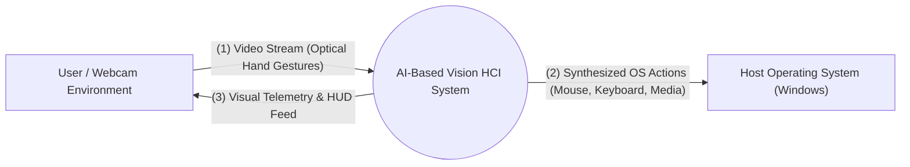
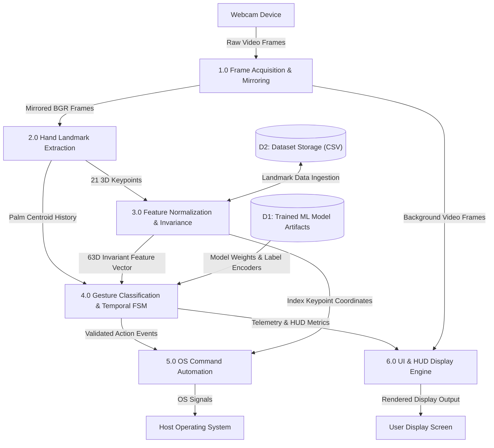
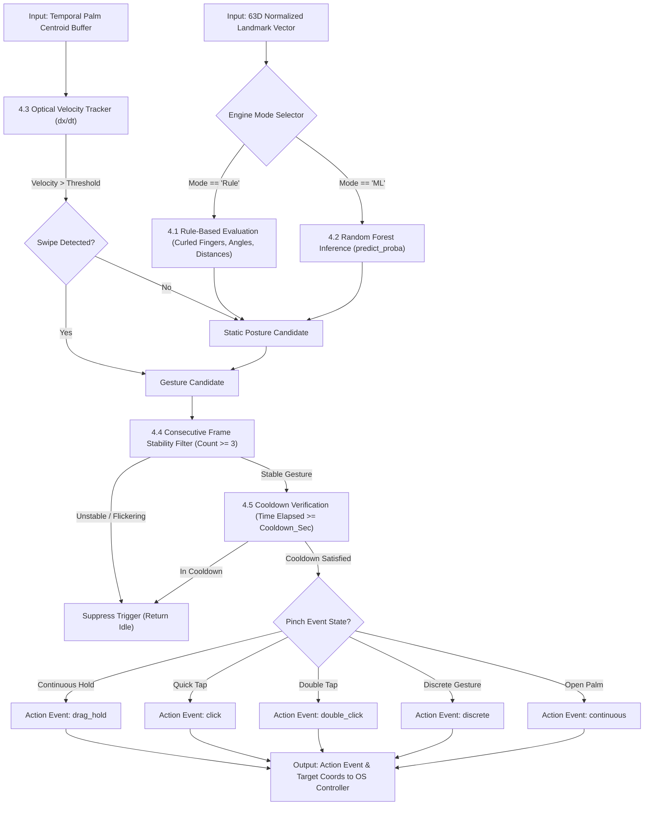

# Data Flow Diagrams (DFD)

This document presents the multi-level Data Flow Diagrams (DFD Level 0, Level 1, and Level 2) for the **AI-Based Vision-Driven Human Computer Interaction System**.

---

## 1. DFD Level 0 — Context Diagram
The Level 0 diagram shows the overall system boundary, external entities (User/Webcam and Host Operating System), and high-level data exchanges.

### Data Dictionary for Level 0:
- **Optical Hand Gestures**: Raw physical hand postures and movements captured at 30 FPS.
- **Synthesized OS Actions**: Cursor coordinates $(X, Y)$, mouse click/release signals, scroll deltas, and multimedia virtual keycodes.
- **Visual Telemetry & HUD Feed**: Mirrored camera stream overlaid with 21-joint skeleton, bounding boxes, gesture classification labels, and FPS counters.

---

## 2. DFD Level 1 — Subsystem Data Flow

The Level 1 diagram breaks the system into its 5 primary functional processes and associated data stores.

### Process Descriptions for Level 1:
1. **Process 1.0 (Frame Acquisition)**: Handles hardware negotiation, frame polling, horizontal flip, and frame rate calculation.
2. **Process 2.0 (Hand Landmark Extraction)**: Employs MediaPipe neural pipeline to localize hand region and compute 21 landmark positions.
3. **Process 3.0 (Feature Normalization)**: Translates coordinates relative to wrist and normalizes by palm reference scale ($d_{ref}$).
4. **Process 4.0 (Gesture Classification & FSM)**: Identifies gesture via geometric rules or trained ML classifier, and validates via debouncing FSM.
5. **Process 5.0 (OS Command Automation)**: Transforms normalized coordinates to screen pixel targets with EMA smoothing and dispatches PyAutoGUI events.
6. **Process 6.0 (UI & HUD Display Engine)**: Composites translucent HUD cards, confidence bars, and skeletons onto the output canvas.

---

## 3. DFD Level 2 — Detailed Process 4.0 (Gesture Classification & State FSM)

The Level 2 diagram details the exact internal decision and transformation logic within the classification subsystem.

