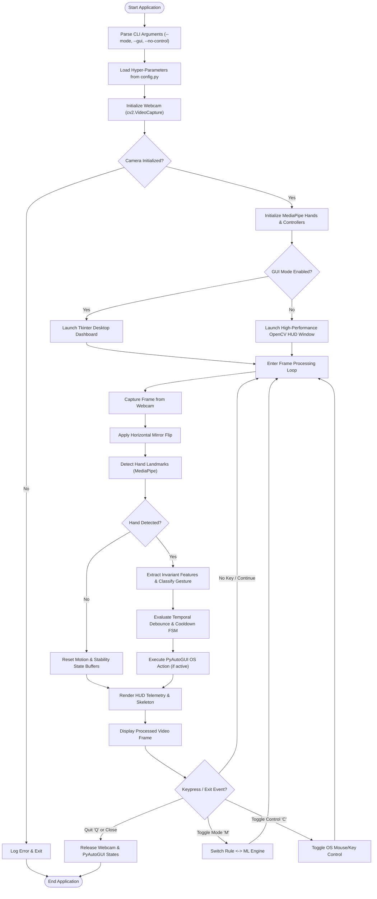
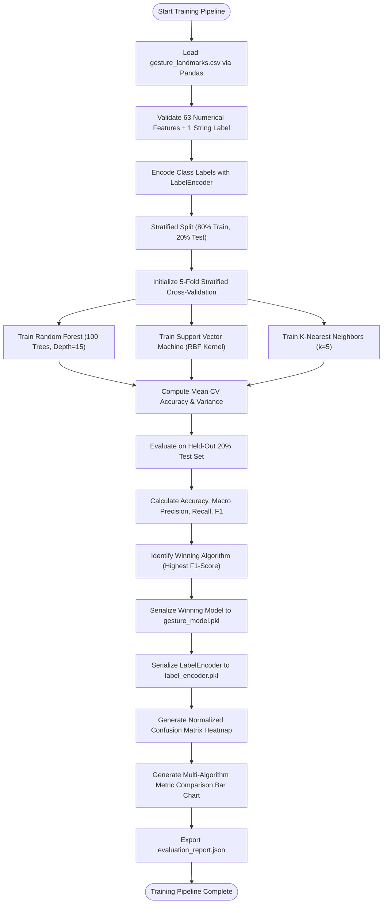

# System Flowcharts

This document illustrates the execution and logic flowcharts for the **AI-Based Vision-Driven HCI System**.

---

## 1. Master Application Flowchart



---

## 2. Gesture Classification & Temporal FSM Flowchart

```mermaid
flowchart TD
    SUB_START(["Input: Normalized Landmarks & Centroid"]) --> SWIPE_CHECK{"Swipe Velocity Spike?"}
    
    SWIPE_CHECK --> |dx/dt > Thresh| SET_SWIPE["Candidate = Swipe Gesture"]
    SWIPE_CHECK --> |No| ENG_CHECK{"Active Engine Mode?"}
    
    ENG_CHECK --> |Mode == 'ML'| ML_INFER["Run Random Forest Inference on 63D Vector"]
    ENG_CHECK --> |Mode == 'Rule'| RULE_INFER["Evaluate Geometric Angles & Finger States"]
    
    ML_INFER --> CONF_CHECK{"Prediction Confidence >= Min Thresh?"}
    CONF_CHECK --> |Yes| SET_ML["Candidate = ML Predicted Class"]
    CONF_CHECK --> |No| SET_IDLE["Candidate = Idle"]
    
    RULE_INFER --> SET_RULE["Candidate = Rule Gesture Class"]
    
    SET_SWIPE --> STAB_ACCUM["Candidate Stability Counter ++"]
    SET_ML --> STAB_ACCUM
    SET_RULE --> STAB_ACCUM
    SET_IDLE --> STAB_ACCUM
    
    STAB_ACCUM --> COUNT_CHECK{"Candidate Count >= Stability Frames?"}
    COUNT_CHECK --> |No| RET_NO_ACTION["Suppress Trigger (Return Idle / No-Op)"]
    COUNT_CHECK --> |Yes| ACTIVATE_GEST["Set Active Gesture = Candidate"]
    
    ACTIVATE_GEST --> TYPE_SWITCH{"Gesture Category?"}
    
    TYPE_SWITCH --> |Open Palm| CURSOR_MOVE["Apply EMA Smoothing -> Move Cursor"]
    TYPE_SWITCH --> |Pinch (Index+Thumb)| PINCH_FSM{"Pinch Duration?"}
    TYPE_SWITCH --> |Middle Pinch| RIGHT_CLICK["Trigger Right Click Event"]
    TYPE_SWITCH --> |Two Fingers (Up/Down)| SCROLL_FSM["Trigger Scroll Event"]
    TYPE_SWITCH --> |Thumb / Three Fingers / Screenshot| COOL_CHECK{"Cooldown Expired?"}
    TYPE_SWITCH --> |Closed Fist| FREEZE["Freeze Cursor Movement"]
    
    PINCH_FSM --> |< 0.28s (Tap)| SINGLE_CLICK["Trigger Left Click"]
    PINCH_FSM --> |Double Tap in 0.4s| DBL_CLICK["Trigger Double Click"]
    PINCH_FSM --> |Held > 0.28s| DRAG_HOLD["Trigger Mouse Down (Drag Mode)"]
    
    COOL_CHECK --> |Yes| TRIGGER_DISCRETE["Dispatch OS Keystroke & Reset Cooldown"]
    COOL_CHECK --> |No| RET_NO_ACTION
    
    CURSOR_MOVE --> SUB_END(["Action Complete"])
    SINGLE_CLICK --> SUB_END
    DBL_CLICK --> SUB_END
    DRAG_HOLD --> SUB_END
    RIGHT_CLICK --> SUB_END
    SCROLL_FSM --> SUB_END
    TRIGGER_DISCRETE --> SUB_END
    FREEZE --> SUB_END
    RET_NO_ACTION --> SUB_END
```

---

## 3. Machine Learning Training & Evaluation Flowchart


