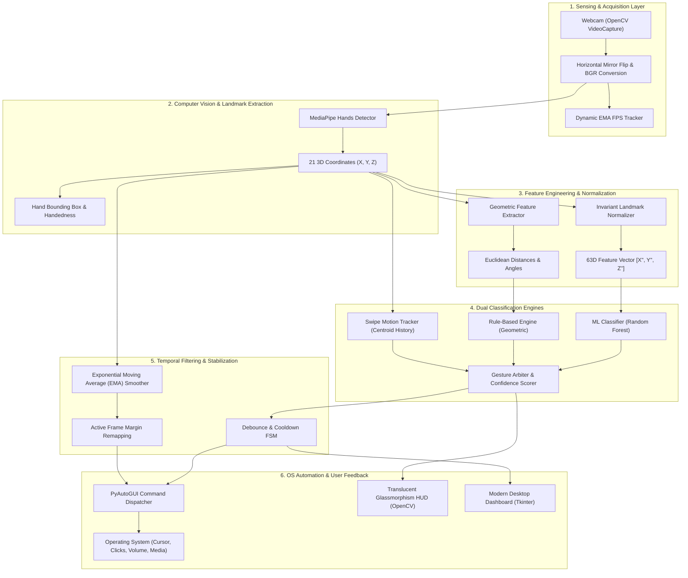

# System Architecture: AI-Based Vision-Driven HCI Using Hand Gesture Recognition

## 1. System Overview
The Vision-Driven Human-Computer Interaction (HCI) system eliminates physical peripheral dependencies (mouse, keyboard, multimedia buttons) by capturing hand gestures through standard monocular webcams. The architecture blends computer vision (MediaPipe Hands), translation- and scale-invariant geometric feature engineering, dual-classifier intelligence (Rule-Based & Machine Learning), temporal state machines, and low-latency operating system automation.

---

## 2. Multi-Tier Architectural Diagram

---

## 3. Subsystem Breakdown

### 3.1 Sensing & Ingestion Layer
- **Component**: `src/vision/camera.py` (`CameraStream`)
- **Role**: Acquires BGR frames at 30 FPS. Applies horizontal mirroring (`cv2.flip(frame, 1)`) so natural user movements to the right shift the cursor rightward.
- **FPS Metering**: Computes instantaneous frame times and applies an Exponential Moving Average (EMA) to prevent flickering frame rate readings.

### 3.2 Keypoint Detection & Tracking Layer
- **Component**: `src/vision/hand_detector.py` (`HandDetector`)
- **Role**: Employs Google MediaPipe's lightweight palm detector and 2.5D landmark regression neural network. Outputs 21 precise 3D keypoint coordinates $(x, y, z)$, where $x, y \in [0, 1]$ are frame-normalized and $z$ represents relative depth relative to the wrist.

### 3.3 Geometric Normalization & Feature Engineering Layer
- **Component**: `src/vision/landmark_utils.py` (`LandmarkProcessor`)
- **Translation Invariance**: Centered around Wrist ($P_0$):
  $$P'_i = P_i - P_0$$
- **Scale Invariance**: Normalized by middle MCP ($P_9$) distance:
  $$d_{ref} = \|P_9 - P_0\|_2, \quad P''_i = \frac{P'_i}{d_{ref}}$$
- **Outputs**: 63-dimensional normalized feature vector $\mathbf{X} \in \mathbb{R}^{63}$, Euclidean fingertip distance matrix, and finger curl angles.

### 3.4 Classification Engine Layer
- **Rule-Based Engine (`src/gestures/rule_engine.py`)**: Uses geometric relationships and finger extension states for immediate zero-calibration control.
- **Machine Learning Engine (`src/gestures/ml_classifier.py`)**: Evaluates the normalized 63D vector using a trained Random Forest / RBF-SVM model with probability confidence scoring.
- **Swipe Detector (`src/gestures/swipe_detector.py`)**: Analyzes temporal velocity vectors $(\Delta X / \Delta t)$ of the palm centroid over a 12-frame sliding window.

### 3.5 Interaction & Stabilization Layer
- **Debounce & Cooldown FSM (`src/gestures/gesture_state.py`)**:
  - Enforces consecutive frame stability ($N = 3$) before activating discrete actions.
  - Imposes cooldown periods (0.45s for volume/media, 0.08s for continuous scroll).
  - Tracks pinch transitions (`click`, `double_click`, `drag_start`, `drag_hold`, `drag_release`).
- **Cursor Smoother (`src/control/smoother.py`)**:
  - Remaps active webcam bounding box to OS resolution.
  - Implements an Exponential Moving Average (EMA) filter ($\alpha = 0.35$) with a 2-pixel deadzone.

### 3.6 OS Automation Layer
- **Component**: `src/control/controller.py` (`ComputerController`)
- **Role**: Dispatches low-level OS events using `pyautogui` with zero artificial sleep delays (`PAUSE = 0.001`), supporting cursor movement, left/right clicks, dragging, scrolling, and multimedia hardware key events.
