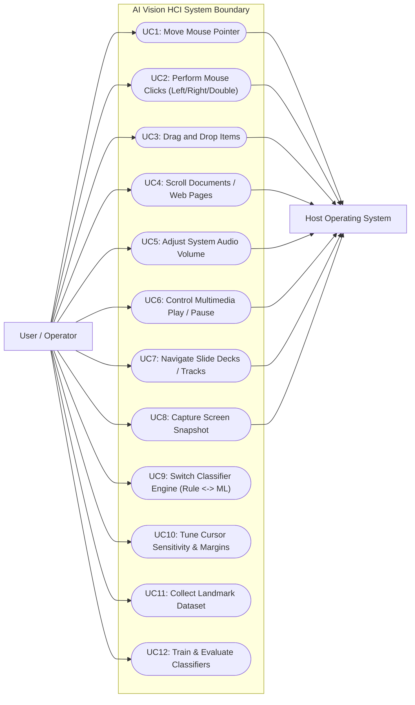
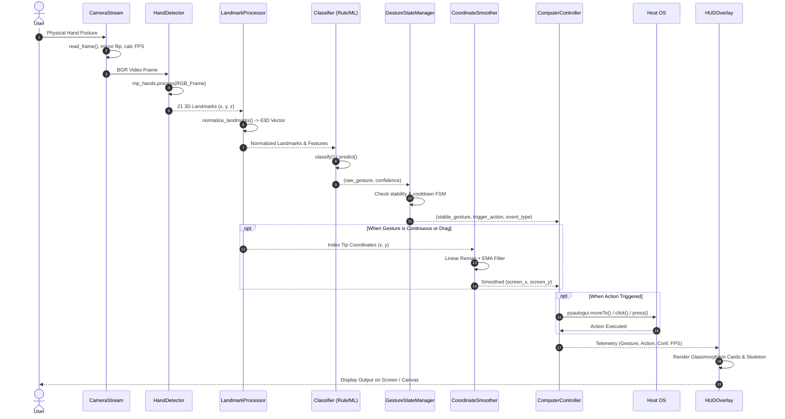

# UML Diagrams: Use Case, Sequence & Class Architecture

This document provides formal Unified Modeling Language (UML) specifications for the **AI-Based Vision-Driven HCI System**.

---

## 1. UML Use Case Diagram

### Use Case Specifications:
- **UC1 (Move Mouse Pointer)**: User extends open palm and shifts hand position within the camera's active zone. System remaps coordinates through the EMA filter and dispatches `pyautogui.moveTo()`.
- **UC2 (Mouse Clicks)**: User touches thumb tip to index tip (left click), thumb tip to middle tip (right click), or performs a quick double pinch (double click).
- **UC3 (Drag and Drop)**: User pinches and holds thumb and index fingertips for $>0.28$ seconds. System triggers `pyautogui.mouseDown()` and keeps it locked until released.
- **UC4 (Scroll)**: User points index and middle fingers up or down. System dispatches `pyautogui.scroll()`.
- **UC5 (Volume)**: User clenches a fist with thumb straight up or down. System increments or decrements master system volume via virtual keycodes.
- **UC7 (Navigate Slides)**: User sweeps hand quickly left or right. System detects horizontal optical velocity spike and fires `nexttrack`/`prevtrack` and arrow keys.

---

## 2. UML Sequence Diagram (Frame Execution Cycle)

---

## 3. UML Class Architecture Diagram

```mermaid
classDiagram
    class CameraStream {
        +int camera_id
        +int width
        +int height
        +float fps
        +start() bool
        +read_frame() Tuple[bool, ndarray]
        +get_fps() float
        +release() void
    }

    class HandDetector {
        +Hands mp_hands
        +find_hands(frame)
        +get_hand_data(shape, index) dict
        +draw_hand_mesh(frame, index, modern) ndarray
        +close() void
    }

    class LandmarkProcessor {
        +normalize_landmarks(landmarks) ndarray
        +get_finger_states(landmarks, hand) List[int]
        +get_pinch_distance(landmarks) float
        +get_middle_pinch_distance(landmarks) float
        +get_palm_center(landmarks) Tuple[float, float]
    }

    class RuleGestureEngine {
        +float pinch_threshold
        +float middle_pinch_threshold
        +classify(landmarks, handedness) Tuple[str, float]
    }

    class MLGestureClassifier {
        +Path model_path
        +bool is_ready
        +load_model() bool
        +predict(landmarks_norm) Tuple[str, float]
    }

    class GestureStateManager {
        +int stability_frames
        +float discrete_cooldown
        +bool is_dragging
        +process(raw_gesture, raw_conf) Tuple[str, bool, str]
        +reset() void
    }

    class CoordinateSmoother {
        +int screen_width
        +int screen_height
        +float alpha
        +smooth_and_map(raw_x, raw_y) Tuple[int, int]
        +reset() void
    }

    class ComputerController {
        +bool enabled
        +bool is_mouse_down
        +set_enabled(state) void
        +move_cursor(x, y) void
        +click(button) void
        +scroll(direction, amount) void
        +volume_up() void
        +volume_down() void
        +dispatch(gesture, event, coords) str
    }

    class HUDOverlay {
        +draw_glass_rect(img, pt1, pt2, color, alpha) ndarray
        +draw_active_region(frame, is_active) ndarray
        +render_hud(...) ndarray
    }

    class HCIPipeline {
        +CameraStream camera
        +HandDetector detector
        +RuleGestureEngine rule_engine
        +MLGestureClassifier ml_classifier
        +GestureStateManager state_manager
        +CoordinateSmoother smoother
        +ComputerController controller
        +HUDOverlay hud
        +start() bool
        +process_one_frame() Tuple[bool, ndarray, dict]
        +stop() void
    }

    HCIPipeline *-- CameraStream
    HCIPipeline *-- HandDetector
    HCIPipeline *-- LandmarkProcessor
    HCIPipeline *-- RuleGestureEngine
    HCIPipeline *-- MLGestureClassifier
    HCIPipeline *-- GestureStateManager
    HCIPipeline *-- CoordinateSmoother
    HCIPipeline *-- ComputerController
    HCIPipeline *-- HUDOverlay
```

